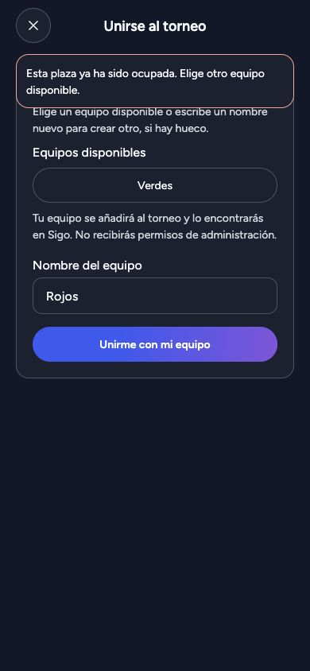
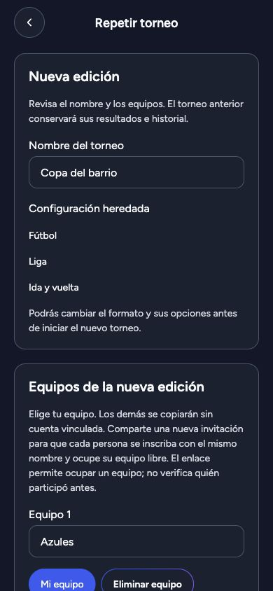

# QA de nuevas ediciones e inscripción — 2026-10-11

Los recorridos previstos pasan en iOS 27.0 y Android 14, probados uno después
del otro. No se encontraron defectos en esta muestra de QA.

ADR-0159 y ADR-0160. Cambios en develop, sin despliegue ni migración de un entorno
persistente. Datos inventados para la UI; la persistencia se prueba por separado.

## Evidencia automatizada

- `make -o openapi-generate-check verify`: correcto. Incluye formato, lint Go/TS,
  typecheck, contrato, suites, exportación web, generación sqlc, build y vulnerabilidades.
- La comprobación OpenAPI basada en diff contra HEAD se excluye porque el código
  generado nuevo sigue sin commit. Se regeneró y comparó el hash de todos los
  archivos generados antes/después: sin diferencias.
- Suite completa PostgreSQL con `TM_RUN_INTEGRATION=1`: correcta (7,993 s),
  PostgreSQL 18.4 aislado. Repetición concurrente, independencia del histórico,
  ocho deportes, tres formatos, reglas originales, permisos, transferencia,
  purga legítima de cuenta, capacidad 64 y reclamación concurrente.
- Migración 00022: Up, Down y Up comprobados en la base desechable.
- Seis pruebas de cliente de repetición/parser/errores: correctas. Problemas
  desconocidos, inválidos y errores técnicos usan el fallback común seguro.
- HTTP verifica autenticación/CSRF, validación, negocio, categorización técnica y
  cancelación; el rechazo ocupado acredita el tipo RFC 9457 y causa de raíz segura.

## Recorridos visuales web

Exportación real del cliente contra una API ficticia aislada en localhost.
Ventanas 1280 × 720 y 390 × 844; tema oscuro y navegador en español.

- Torneo acabado: la propietaria tiene «Repetir torneo».
- Formulario: nombre y equipos editables, selección del equipo propio;
  formato Liga y opción Ida y vuelta heredados.
- Error 500: banner común seguro; conservación del formulario y reintento.
- Creación: navegación a edición nueva, equipos sin partidos y configuración
  heredada. El payload pone primero el equipo propio seleccionado.
- Acceso directo sin propiedad: rechazo seguro sin formulario.
- Invitación: equipos Rojos/Verdes visibles, elegir Rojos completa el campo.
- Rechazo 409 ocupado: banner específico, Rojos desaparece de opciones,
  Verdes permanece y el campo conserva Rojos.
- Pantalla estrecha: cards y margen exterior, campos/acciones legibles,
  contenido de repetición desplazable.

La primera fixture devolvía la biblioteca en un orden incompatible con el parser
estricto. Se corrigió la fixture y se repitió la carga de la edición; no se relajó
el contrato del producto.

## Límites y cierre

Las continuaciones iOS y Android se documentan abajo; el ancho móvil web se
distingue de la evidencia nativa. Las pruebas HTTP simulan categorías técnicas, sin
inyectar fallos individuales en cada sentencia SQL. No hay nueva dependencia.

Los servicios local/dev y observabilidad no se arrancaron. PostgreSQL temporal y
servidor de fixture se apagan al cerrar; producción no se toca.

Retrospectiva: el estado visual libre es una instantánea. El lock y el problema
ocupado tipado mantienen el dato correcto y permiten recuperar la interacción
sin duplicar el equipo ni borrar la entrada de la persona.

## Continuación nativa: iOS primero

iPhone 18 Pro, iOS 27.0, development build instalada que ya incluye los módulos
nativos. Bundle actual servido por Metro estrictamente local. Device Hub y
accesibilidad controlan la app; el tema observado es claro.

Pasan la acción del torneo acabado, formulario desplazable, edición del nombre,
rechazo de equipos duplicados, selección de segundo equipo propio y creación de
la nueva edición. Un HTTP 500 ficticio muestra el fallback seguro y conserva las
entradas; el reintento envía Rojos QA primero y Azules después, con una misma intención.
La edición abre publicada y su árbol muestra Liga e Ida y vuelta seleccionadas.

La invitación muestra Rojos y Verdes. Elegir Rojos completa el campo; el 409 ocupado
muestra el banner específico, elimina Rojos de las opciones y conserva el campo.
Escribir Nuevos iOS permite enviar la inscripción y navegar a la edición. Esta
fixture acredita interacción y adaptación HTTP, no el alta persistida del equipo.
El teclado de software se observa con el campo enfocado; la acción sigue accesible
por accesibilidad. Un enlace directo sin propiedad rechaza el formulario.

Evidencia: [creación](evidence/tournament-repetition-2026-10-11/ios-created.png),
[ocupado](evidence/tournament-repetition-2026-10-11/ios-occupied.png),
[error](evidence/tournament-repetition-2026-10-11/ios-error.png),
[teclado](evidence/tournament-repetition-2026-10-11/ios-keyboard.png),
[sin propiedad](evidence/tournament-repetition-2026-10-11/ios-forbidden.png).

`expo install --check` avisa de cinco parches disponibles frente a las versiones
fijadas; no se actualizan dependencias en esta QA. Metro inicialmente anunciaba
127.0.0.1 con socket IPv6: anunciar localhost manteniendo `--localhost` resolvió
la conexión sin exposición LAN. iOS se apagó antes de arrancar Android.

## Continuación nativa: Android después

Pixel API 34 / Android 14, development build existente con módulos requeridos y
bundle actual de Metro. El usuario autoriza expresamente ADB para interacción,
entrada y captura. iOS permanece apagado. El emulador usa dos núcleos, sin ventana,
y las conexiones a Metro/API usan `adb reverse`, sin exposición LAN.

| Recorrido | iOS | Android |
| --- | --- | --- |
| Acción Repetir en torneo finalizado | Pasa | Pasa |
| Edición de nombre y rechazo de equipos duplicados | Pasa | Pasa |
| Selección del segundo equipo propio y orden del payload | Pasa | Pasa |
| HTTP 500 seguro, campos conservados y reintento | Pasa | Pasa |
| Edición nueva publicada, Liga e Ida y vuelta heredadas | Pasa | Pasa |
| Invitación con equipos libres y nombre editable | Pasa | Pasa |
| 409 ocupado, banner específico, lista actualizada, nombre conservado | Pasa | Pasa |
| Elegir otro equipo libre tras el conflicto y enviar | Selección visible; envío alternativo nuevo | Pasa |
| Enviar un nombre nuevo y navegar a la edición | Pasa | Pasa |
| Teclado de software con campo enfocado | Pasa | Pasa |
| Enlace directo sin propiedad rechaza formulario | Pasa | Pasa |

Android envía «Copa QA Android» con «Rojos QA Android» primero y «Azules» después.
La edición muestra esos equipos y los controles heredados. Después del 409,
solo Verdes permanece disponible y Rojos queda en el campo. Elegir Verdes lo
completa y el envío vuelve a la edición. Reabrir permite escribir «Nuevos Android»
y enviar; el teclado deja visibles campo y acción de inscripción.

Evidencia: [formulario](evidence/tournament-repetition-2026-10-11/android-form.png),
[duplicados](evidence/tournament-repetition-2026-10-11/android-duplicate.png),
[error](evidence/tournament-repetition-2026-10-11/android-error.png),
[creación](evidence/tournament-repetition-2026-10-11/android-created.png),
[herencia](evidence/tournament-repetition-2026-10-11/android-inherited.png),
[ocupado](evidence/tournament-repetition-2026-10-11/android-occupied.png),
[elección libre](evidence/tournament-repetition-2026-10-11/android-free-team.png),
[teclado](evidence/tournament-repetition-2026-10-11/android-keyboard.png),
[sin propiedad](evidence/tournament-repetition-2026-10-11/android-forbidden.png).

El tema nativo observado es claro; web se revisó en oscuro. No se afirma cobertura
exhaustiva de ambos temas en todos los SO, ni QA de distribución Release por tienda.
La API ficticia acredita la UI/adaptación HTTP; persistencia, carrera y autorización
real siguen cubiertas por la suite PostgreSQL. No se necesitaron cambios de producto.

Metro, API ficticia y emulador Android quedan apagados. No se arranca observabilidad
ni se despliega ninguna migración. Se conserva evidencia y estado de los dispositivos.

Retrospectiva: capturar un aviso antes de esperar el árbol completo permite conservar
el banner transitorio. Para pantallas de navegación hay que confirmar primero el
destino: la captura demasiado temprana todavía muestra la ruta anterior. La captura
del rechazo se repitió tras confirmar su árbol, sin cambiar el producto.

